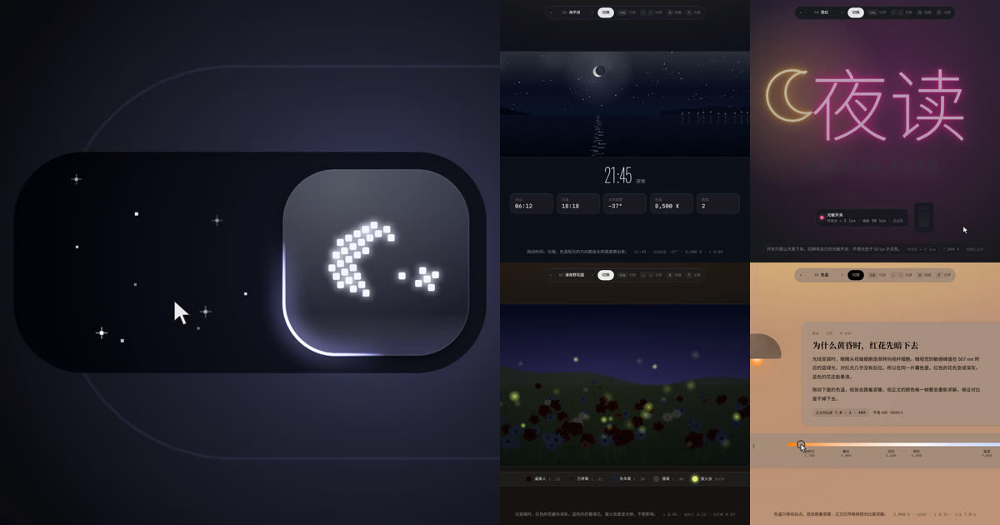

# ui-moments

好的界面，往往赢在某一个瞬间。这里收集这样的瞬间：每一个都能直接上手玩，附一段录屏，并写清灵感来自谁、我们改进了哪里。

**在线体验：[guanmo-ai.github.io/ui-moments](https://guanmo-ai.github.io/ui-moments/)**

[](https://guanmo-ai.github.io/ui-moments/)

## 作品

| 作品 | 说明 | 灵感来源 |
| --- | --- | --- |
| [昼夜开关](gallery/day-night-toggle/) | 像素点沿螺旋重组成月亮，轮廓光绕拨钮转一圈，可以拖到一半停住 | [@kaolti](https://x.com/kaolti/status/2119151022014894260) |
| [调光旋钮](gallery/light-scenes/) | 光从旋钮出发，按距离依次照亮每张卡片 | [@chetaslua](https://x.com/chetaslua/status/2119353034165891308) |
| [海平线](gallery/light-scenes/) | 拖动时间，太阳落下，灯塔和窗户依次亮起 | [@chetaslua](https://x.com/chetaslua/status/2119353034165891308) |
| [浦肯野花园](gallery/light-scenes/) | 光变暗时红花最先消失，萤火虫不受影响 | 原创 |
| [霓虹招牌](gallery/light-scenes/) | 天黑到 50 lux 以下，招牌带着闪烁依次点亮 | 原创 |
| [色温台灯](gallery/light-scenes/) | 拖动色温，整页纸面跟着变暖 | [@chetaslua](https://x.com/chetaslua/status/2119353034165891308) |

每个作品是一个不依赖构建的 HTML 文件，下载后用浏览器直接打开即可。

## 本地运行

```bash
npm run dev        # 打开 http://localhost:5173
```

## 录制视频

作品页面内置录制模式：画面由虚拟时钟逐帧推进，光标操作由脚本控制，所以每次录出来的视频完全一样，不掉帧。

```bash
npm install
npm run record:toggle          # out/day-night-toggle.mp4，2880×2160，60fps
npm run record:light-scenes    # out/light-scenes.mp4，2880×1800，60fps
```

需要 Node.js 20+ 和 ffmpeg。用法见 [tools/record.js](tools/record.js) 开头的说明。

## 新增作品

1. 在 `gallery/<作品名>/` 放入 `index.html`、预览视频、封面图和 `README.md`（写明灵感来源和改进点）。
2. 在 [gallery/works.js](gallery/works.js) 里加一项，首页会自动出现。

## 参考与署名

我们会参考别人的作品，也会把参考了谁写清楚。规则见 [参考与署名](docs/attribution.md)。

## 许可

代码以 [MIT](LICENSE) 许可发布。
