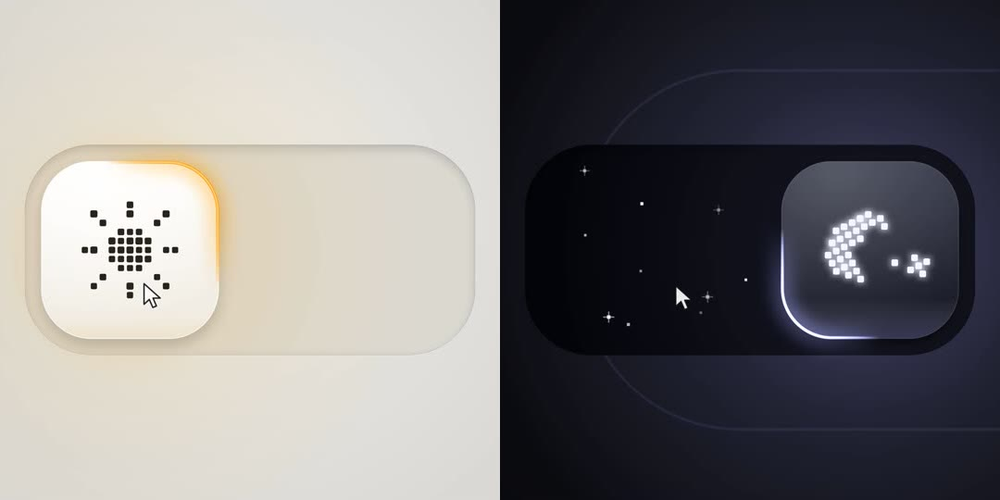

# 观默 UI · Guanmo UI

把界面的细节做到最好：每个作品都能直接打开操作，附一段录屏，并写清参考了谁、改进了哪里。

> 现在是第一版，只有画廊和录制工具。设计 Skill 正在搭建，完成后会放在本仓库。

## 作品

| 作品 | 预览 | 灵感来源 |
| --- | --- | --- |
| [昼夜开关](gallery/day-night-toggle/) | <a href="gallery/day-night-toggle/preview.mp4"></a> | [@kaolti 的明暗开关](https://x.com/kaolti/status/2119151022014894260) |

每个作品是一个不依赖构建的 HTML 文件，用浏览器直接打开即可。

## 录制视频

作品页面内置录制模式：画面由虚拟时钟逐帧推进，光标操作由脚本控制，所以每次录出来的视频完全一样，不掉帧。

```bash
npm install
npm run record:toggle        # 输出 out/day-night-toggle.mp4，2880×2160，60fps
```

需要 Node.js 20+ 和 ffmpeg。录制工具的用法见 [tools/record.js](tools/record.js) 开头的说明。

## 参考与署名

我们会参考别人的作品，也会把参考了谁写清楚。规则见 [参考与署名](docs/attribution.md)。

## 许可

代码以 [MIT](LICENSE) 许可发布。各作品引用的第三方资源，以作品目录里注明的许可为准。
