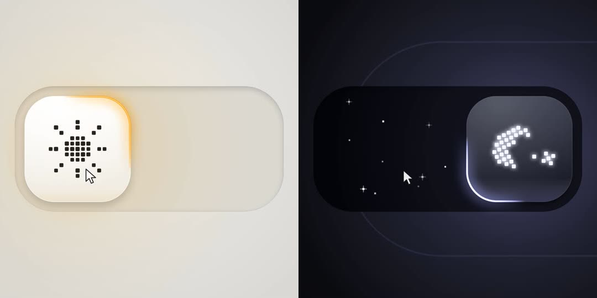

# 昼夜开关

一个明暗切换开关。点击或拖动拨钮，图标、轮廓光和背景一起在白天和夜晚之间变化。

- 打开 [index.html](index.html) 即可操作；拖到一半松开前，画面会停在中间状态。
- 录屏：[preview.mp4](preview.mp4)（1440×1080，60fps，16 秒）。仓库根目录运行 `npm run record:toggle` 可录制 2880×2160 版本。

## 灵感来源

[@kaolti（Zsolt Kacso）的明暗开关](https://x.com/kaolti/status/2119151022014894260)：玻璃质感的方形拨钮、点阵图标、琥珀色与淡紫色的轮廓光。

我们借鉴了这几个视觉元素，代码全部自己写，没有使用原作的代码或素材。

## 我们改进了什么

- **图标变形**：太阳和月亮的像素点一一对应，每个点沿螺旋轨迹飞到新位置，不是随机打散再拼回。
- **可以拖到中间**：图标变形、轮廓光位置和背景明暗都跟随拨钮位置，停在半路就是一个完整的中间状态。
- **轮廓光会动**：拨钮移动时轮廓光绕它转一圈，移动越快尾巴越长。
- **手感**：按下时压扁，移动时拉长，到位时弹簧回弹并荡开一圈光波。
- **夜晚细节**：轨道里有像素星星闪烁；背景从白天到夜晚经过一段偏紫的蓝调，不是直接变灰。
- **可访问性**：有真实的 `role="switch"` 按钮，支持键盘（Tab 聚焦，空格切换）、跟随系统亮暗设置、尊重“减少动态效果”设置。

## 实现

单个 HTML 文件，无依赖。整个画面用一张 canvas 绘制，颜色在 OKLab 空间里插值。录制模式下由 `window.__step` 逐帧推进，脚本在文件末尾的 `SCRIPT()` 里。
